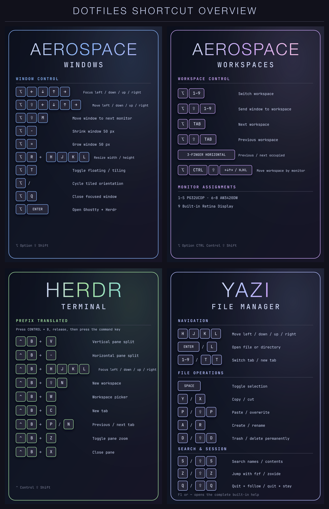

# Pabu's dotfiles

These guides cover macOS and Omarchy installation, updates, keyboard ownership,
and recovery for the dotfiles in this repository.

## Installation paths

Run these commands from an existing repository checkout:

| Platform | Preview | Apply | Optional additions |
| --- | --- | --- | --- |
| macOS 15.6+ | `./setup/bootstrap.sh --dry-run` | `./setup/bootstrap.sh` | `--include-trials` installs Orion; `--upgrade` upgrades declared packages |
| Existing Omarchy desktop | `./setup/bootstrap-omarchy.sh --dry-run` | `./setup/bootstrap-omarchy.sh` | `--gaming` installs Steam, Input Remapper, and WowUp-CF |

macOS uses `Brewfile` for standard packages and `Brewfile.trials` for opt-in
trials. Omarchy has its own package lists and preserves its Ghostty settings.
Both bootstraps remove an installed Cliamp. Trial and gaming flags apply to the
current run; omitting them later leaves those applications installed.

## Guides

- [Windows setup proposal and tool coverage](research/windows-tool-coverage.html), research only; Windows installation is not implemented yet.
- [Bootstrap, updates, and Stow usage](setup.html)
- [Omarchy bootstrap and Bash integration](omarchy.html)
- [AeroSpace workflow and keybindings](aerospace.html)
- [Ghostty and Herdr keybindings](terminal.html)
- [Menu-bar icon management](menubar.html)
- [Code archive offload](migrate-stale-projects.html)

## Keyboard ownership

| Layer | Owner |
| --- | --- |
| macOS windows and workspaces | AeroSpace |
| Three-finger horizontal workspace swipes | SwipeAeroSpace |
| Focused-window outline | JankyBorders, supervised by a Homebrew login service |
| Native menu-bar icon visibility | Selected Hidden Bar or Thaw provider |
| Omarchy desktop bindings, monitors, and keyboard layout | Hyprland overlays under `omarchy-desktop` |
| Omarchy dictation | Selected backend; Handy is chosen only when no backend is configured |
| Terminal workspaces, tabs, panes, navigation, zoom, and resize | Herdr |
| macOS clipboard, search, font size, terminal windows, and fullscreen | Managed Ghostty config; Omarchy keeps its own settings |

Every cheat sheet uses explicit macOS modifier names. There is no implied or
unexplained `Mod` key.

## Visual shortcut cards

[Open the complete dotfiles shortcut overview](assets/dotfiles-shortcuts-overview.png).

The individual cards remain available beside the relevant written guides:

- [AeroSpace window shortcuts](assets/aerospace-windows-shortcuts.png)
- [AeroSpace workspace shortcuts](assets/aerospace-workspaces-shortcuts.png)
- [Herdr terminal shortcuts](assets/herdr-terminal-shortcuts.png)
- [Yazi file-manager shortcuts](assets/yazi-shortcuts.png)
